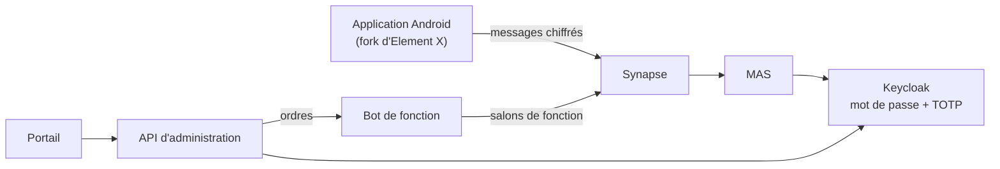

# MESSAF – Messagerie sécurisée de l'administration du Faso

Messagerie chiffrée de bout en bout, hébergée sur l'infrastructure de l'État et réservée aux agents enrôlés. Équipe **Challengers** (Institut Supérieur de Génie Électrique du Burkina Faso) : SANOU Tolo Thède Axel (infrastructure et sécurité), OUEDRAOGO Nebwaogo Lionnel (innovation et interfaces). Hackathon 226 – Édition 2026.

## Concept

MESSAF suit les **fonctions administratives**, pas seulement les personnes : on écrit au « DRH du ministère de la Santé ». En cas de mutation ou de congé, le successeur ou l'intérimaire reprend le fil, avec son historique, et le service continue.

## Architecture



Synapse ne stocke que des messages chiffrés ; fédération et inscription fermées. MAS ouvre les sessions et confie l'identification à Keycloak. L'API (Python) enrôle, révoque, tient le registre des fonctions et le journal d'audit ; le portail (React) est cloisonné par rôle et par ministère ; le bot de fonction (Rust) exécute passations et intérims. Chiffrement Olm et Megolm (Matrix) par vodozemac, sans cryptographie maison : voir la [note de sécurité](docs/MESSAF_Note_de_securite.pdf).

## Fonctionnalités démontrées

- **Enrôlement** : code d'activation à usage unique ; mot de passe, TOTP et codes de secours imposés.
- **Révocation** : compte bloqué, sessions fermées ; l'application se déconnecte en deux minutes au plus.
- **Passation et intérim** (innovation principale) : le successeur reçoit les salons de la fonction, leur historique chiffré (MSC4268) et un dossier de passation ; le sortant est retiré. L'intérimaire, validé par le supérieur, reçoit les affaires en cours sans l'historique. Dans l'application, chaque auteur apparaît « en qualité de » sa fonction.
- **Salons classés** (Diffusion restreinte, Confidentiel) : seuls les agents habilités y entrent ; captures d'écran bloquées, transfert et copie retirés. Code PIN de l'application obligatoire.
- **Journal d'audit** en ajout seul, refus compris.

Dossiers : `deploy/` (configuration), `api/`, `portail/`, `bots/fonction/`, `tests/`, `docs/`. Application : [messaf-android](https://github.com/nouxel00/messaf-android).

## Technologies et licences

Détail des bibliothèques dans le README de chaque dossier.

| Composant | Rôle | Licence |
| --- | --- | --- |
| [Synapse](https://github.com/element-hq/synapse) | Serveur Matrix | AGPL-3.0 |
| [Element X Android](https://github.com/element-hq/element-x-android) | Application (fork) | AGPL-3.0 |
| [Matrix Authentication Service](https://github.com/element-hq/matrix-authentication-service) | Sessions, relais vers Keycloak | AGPL-3.0 |
| [Keycloak](https://www.keycloak.org) | Comptes, second facteur, rôles | Apache-2.0 |
| [PostgreSQL](https://www.postgresql.org) | Bases de données | PostgreSQL |
| [matrix-rust-sdk](https://github.com/matrix-org/matrix-rust-sdk), tokio, axum | Bot de fonction | Apache-2.0, MIT |
| [FastAPI](https://fastapi.tiangolo.com), httpx, PyJWT, psycopg, fpdf2 | API d'administration | MIT, BSD, LGPL-3.0 |
| [React](https://react.dev), keycloak-js | Portail | MIT, Apache-2.0 |
| [ntfy](https://github.com/binwiederhier/ntfy) | Notifications sans Google | Apache-2.0 / GPL-2.0 |
| [FreeOTP](https://freeotp.github.io) | Codes à usage unique | Apache-2.0 |
| [Docker Compose](https://github.com/docker/compose) | Déploiement | Apache-2.0 |

## Niveau d'engagement

**Étendre et adapter** : MESSAF s'appuie sur Synapse, MAS et Element X, et y ajoute ses composants. Code de l'équipe sous AGPL-3.0 (`LICENSE`).

## Installation

Prérequis : Docker avec Compose v2, Node.js 20 ou plus, et pour l'application un téléphone Android avec `adb`.

```
copy .env.example .env        (Linux : cp .env.example .env)
docker compose up -d
```

Renseigner dans `.env` : `POSTGRES_PASSWORD`, `KEYCLOAK_ADMIN_PASSWORD`, `MESSAF_DEMO_PASSWORD` (12 caractères minimum). Portail : `cd portail`, créer `.env.local` ([portail/README.md](portail/README.md)), `npm install`, `npm run dev`, puis http://localhost:5173. Application : installer l'APK de la [dernière version de messaf-android](https://github.com/nouxel00/messaf-android/releases/latest), lancer `deploy\relier-telephones.bat`, adresse `http://localhost:8008`. Vérifications : [deploy/README.md](deploy/README.md). Tests de sécurité (serveur aveugle, intrus, révocation) : `docker compose --profile tests run --rm tests` ([tests/README.md](tests/README.md)).

## Comptes de démonstration

Comptes fictifs : identifiant = matricule, mot de passe provisoire = `MESSAF_DEMO_PASSWORD`, TOTP à la première connexion. **100002** Paul Zongo, administrateur Santé (passations, révocation) · **100003** Mariam Traoré, RH (enrôlement, absences) · **100004** Jean Compaoré, supérieur (intérims) · **100005 à 100008** agents, dont Awa Ouédraogo (DRH), Issa Sawadogo et Moussa Kaboré · **100009** Salif Ouattara, auditeur · **100011** Boukary Nikéma, administrateur Finances (cloisonnement).

## Limites connues

- Prototype local : HTTP sans TLS sur `localhost`, Keycloak en mode développement, un seul serveur.
- Le bot de fonction détient les clés des salons de fonction : composant de confiance. L'historique n'est transmis qu'aux appareils vérifiés existant au moment de l'invitation.
- Un administrateur de la base peut retirer les déclencheurs qui protègent le journal d'audit.
- Le niveau de classification est fixé par salon et visible du serveur ; notifications et visionneuse de médias ne sont pas encore restreintes dans un salon classé.
- Pas encore réalisés : bot archiviste, convocations, suivi des actions, classification par message, messages éphémères.
